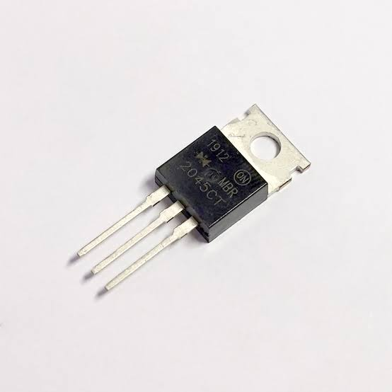

import QuizComponent from '../components/QuizComponent';
import CloudImage from '../../components/CloudImage.tsx';
import LEDIcon from '../components/Cathod.tsx';  
import Diode from "../simulator/Diode.tsx";

# Chapter 1: Diode (နှစ်ခုခံမှုပစ္စည်း)  

## မိတ်ဆက်  

**Diode** သည် **Electronics** လောကတွင် အရေးကြီးဆုံး **Semiconductor Components** များထဲမှ တစ်ခု ဖြစ်ပါသည်။

**Resistor** သည် **Current** ကို ထိန်းချုပ်ပေးပြီး **Capacitor** သည် **Electrical Charge** ကို သိုလှောင်ပေးသကဲ့သို့ **Diode** သည်လည်း **Current** ကို **Direction** တစ်ခုတည်းသို့သာ စီးဆင်းခွင့်ပြုသော **Component** ဖြစ်ပါသည်။

Phone Charger များ၊ Power Supply များ၊ LED Lights များ၊ Solar Systems များနှင့် Computer Circuit များတွင် Diode များကို အလွန်ကျယ်ပြန့်စွာ အသုံးပြုကြပါသည်။

<LEDIcon />
---

## 🤔 Diode ဆိုတာ ဘာလဲ?

Diode ဆိုသည်မှာ Electrical Current ကို Direction တစ်ခုတည်းသို့သာ စီးဆင်းခွင့်ပြုပြီး ဆန့်ကျင်ဘက် Direction တွင် Current စီးဆင်းခြင်းကို တားဆီးပေးသော Semiconductor Device တစ်ခု ဖြစ်ပါသည်။

ရိုးရိုးရှင်းရှင်း ပြောရလျှင်

```text
Current Allowed
      ↓
    ─|>|─
      ↓
One Direction Only
```

Diode ကို Electronic Circuit များတွင် Current Flow ကို ထိန်းချုပ်ရန် အသုံးပြုကြပါသည်။

<Diode />

---

## 🧠 Semiconductor Device ဆိုတာ ဘာလဲ?

Diode သည် Semiconductor Device အမျိုးအစားတစ်ခု ဖြစ်ပါသည်။

Semiconductor ဆိုသည်မှာ

Conductor (Current ကောင်းစွာ စီးနိုင်သော Material)

နှင့်

Insulator (Current မစီးနိုင်သော Material)

တို့၏ အလယ်အလတ်ဂုဏ်သတ္တိရှိသော Material ကို ခေါ်ပါသည်။

**ဥပမာ:**

```text
Copper
   ↓
Conductor

Silicon
   ↓
Semiconductor

Plastic
   ↓
Insulator
```

Diode များကို အများအားဖြင့် Silicon ဖြင့် ထုတ်လုပ်ကြပါသည်။

Silicon ၏ ထူးခြားချက်မှာ Current ကို လိုအပ်သလို ထိန်းချုပ်နိုင်ခြင်း ဖြစ်ပါသည်။

ဒါကြောင့်

* Diode
* Transistor
* Integrated Circuit (IC)

များအားလုံးကို Semiconductor Technology ဖြင့် တည်ဆောက်ထားကြပါသည်။

---

## 🚪 Diode ကို One-Way Gate လို့ စဉ်းစားကြည့်ပါ

Diode ကို One-Way Gate (သို့) One-Way Door တစ်ခုလို မြင်နိုင်ပါသည်။

**ဥပမာ:**

```text
Door
 ↓

Allowed →
Blocked ←
```

တံခါးတစ်ချပ်သည် Direction တစ်ဖက်တည်းမှသာ ဖွင့်နိုင်သလို

Diode သည်လည်း Current ကို Direction တစ်ဖက်တည်းသို့သာ စီးဆင်းခွင့်ပြုပါသည်။

---

## ⚡ Current ကို Direction တစ်ခုတည်း စီးခွင့်ပြုတယ်

Diode ၏ အဓိကအလုပ်မှာ Current ကို Direction တစ်ခုတည်းသို့သာ စီးခွင့်ပြုခြင်း ဖြစ်ပါသည်။

ဥပမာ

```text
Battery (+)
     │
     ▼
   ─|>|─
     ▼
Battery (-)
```

ဒီ Direction တွင် Current စီးနိုင်ပါသည်။

သို့သော်

```text
Battery (+)

   ─|<|─

Battery (-)
```

ဆိုပါက Current စီးဆင်းမှုကို တားဆီးထားမည် ဖြစ်ပါသည်။

ဒါကြောင့် Diode ကို

```text
Electrical One-Way Valve
```

ဟုလည်း ခေါ်ဆိုနိုင်ပါသည်။

---

## 🌍 Real World Applications

Diode များကို နေ့စဉ်အသုံးပြုနေသော Electronic Devices များစွာတွင် တွေ့နိုင်ပါသည်။

**ဥပမာ:**   

* **Phone Charger**

AC ကို DC ပြောင်းရန် Diode များ အသုံးပြုသည်။

* **LED Bulbs**

LED ဆိုသည်မှာ Light Emitting Diode ဖြစ်သည်။

* **Solar Systems**

Battery ထဲသို့ Current ပြန်စီးခြင်းကို တားဆီးရန် အသုံးပြုသည်။

* **Power Supplies**

Circuit များကို Reverse Current မှ ကာကွယ်ရန် အသုံးပြုသည်။

---

## 🎯 ဒီ Chapter မှာ ဘာတွေ လေ့လာမလဲ?

ဒီ Chapter တွင်

✅ Diode ဆိုတာဘာလဲ?

✅ Diode Symbol

✅ Anode နှင့် Cathode

✅ Forward Bias

✅ Reverse Bias

✅ Diode Voltage Drop

✅ Diode Types

✅ Real World Applications

တို့ကို လေ့လာသွားမည် ဖြစ်ပါသည်။

---

## 📌 မှတ်သားရန်

✅ Diode သည် Semiconductor Device တစ်ခု ဖြစ်သည်။

✅ Silicon ကို အများဆုံး အသုံးပြု၍ ထုတ်လုပ်သည်။

✅ Current ကို Direction တစ်ခုတည်းသို့သာ စီးခွင့်ပြုသည်။

✅ Reverse Direction တွင် Current စီးဆင်းမှုကို တားဆီးသည်။

✅ Power Supply, Charger, LED နှင့် Solar Circuit များတွင် အသုံးများသည်။

✅ Diode ကို Electrical One-Way Valve ဟု သတ်မှတ်နိုင်သည်။


---  


## 🔷 Diode Symbol and Structure

Diode ကို Circuit Diagram များတွင် အထူး Symbol တစ်ခုဖြင့် ဖော်ပြကြပါသည်။

Diode တစ်လုံးကို မှန်ကန်စွာ အသုံးပြုနိုင်ရန် Symbol၊ Terminal များနှင့် Physical Structure ကို နားလည်ထားရန် အရေးကြီးပါသည်။

ဒီ Section တွင်

* Diode Symbol
* Anode
* Cathode
* Physical Structure
* Cathode Band

တို့ကို လေ့လာသွားပါမည်။

---

## 📐 Diode Symbol

Circuit Diagram များတွင် Diode ကို အောက်ပါ Symbol ဖြင့် ဖော်ပြကြပါသည်။

```text
Anode      Cathode
  │            │
 ────────|>|──────────
```

ဒီ Symbol တွင်

```text
|>
```

သည် Current စီးနိုင်သော Direction ကို ဖော်ပြထားခြင်း ဖြစ်ပါသည်။

Current သည်

```text
Anode → Cathode
```

Direction ဖြင့်သာ စီးဆင်းနိုင်ပါသည်။

---

## 🧭 Symbol ကို ဘယ်လို ဖတ်ရမလဲ?

Diode Symbol ကို ဖတ်ရာတွင်

```text
──|>|──
```

၏

Left Side သည်

```text
Anode
```

ဖြစ်ပြီး

Right Side သည်

```text
Cathode
```

ဖြစ်ပါသည်။

---

## 🔵 Anode ဆိုတာ ဘာလဲ?

Anode သည် Diode ၏ Positive Side ဖြစ်ပါသည်။

Current သည် Anode မှ Diode ထဲသို့ ဝင်ရောက်ပါသည်။

```text
Current In
     ↓
Anode
```

Forward Bias အခြေအနေတွင် Current သည် Anode မှ ဝင်ရောက်ပြီး Cathode မှ ထွက်သွားပါသည်။

---

## 🔴 Cathode ဆိုတာ ဘာလဲ?

Cathode သည် Diode ၏ Negative Side ဖြစ်ပါသည်။

Current သည် Cathode ဘက်မှ ထွက်သွားပါသည်။

Diode အလုပ်လုပ်သောအခါ Current Flow Direction သည်

```text
Anode → Cathode
```

ဖြစ်ပါသည်။

---

## 📌 မှတ်သားရန်

Diode Symbol ကို ကြည့်လိုက်သည်နှင့်

```text
──|>|──
```

Arrow သွားမည့်ဘက်ကို Current Direction ဟု မှတ်ထားနိုင်ပါသည်။

```text
Anode → Cathode
```

---

## 🏗️ Diode Structure

Diode တစ်လုံးကို Semiconductor Material နှစ်မျိုးဖြင့် တည်ဆောက်ထားပါသည်။

### P-Type Material

Positive Charge Carrier များ ပိုမိုရှိသည်။

### N-Type Material

Negative Charge Carrier များ ပိုမိုရှိသည်။

```text
P-Type | N-Type
```

ဒီ Semiconductor နှစ်ခု ပေါင်းစပ်ထားခြင်းကို

```text
PN Junction
```

ဟု ခေါ်ပါသည်။

Diode ၏ အဓိက အလုပ်လုပ်ပုံသည် PN Junction ပေါ်တွင် မူတည်ပါသည်။

---

## 🔬 PN Junction ဆိုတာ ဘာလဲ?

Diode ၏ အတွင်းတွင်

```text
P-Type
   │
PN Junction
   │
N-Type
```

ဖွဲ့စည်းပုံ ရှိပါသည်။

ဒီ Junction သည်

Current ကို Direction တစ်ခုတည်းသို့သာ စီးခွင့်ပြုစေသော အဓိက အစိတ်အပိုင်း ဖြစ်ပါသည်။

---

## 📷 Real Diode Structure

Physical Diode တစ်လုံးကို အောက်ပါအတိုင်း မြင်နိုင်ပါသည်။

```text
     Band
      ↓
 ┌────────────┐
 │   Diode    │
 └────────────┘
   │        │
 Anode   Cathode
```

Diode Body ပေါ်တွင် အမှတ်အသား Band တစ်ကြောင်း ပါရှိပါသည်။



---

## 🎯 Cathode Band

Diode ကို လက်တွေ့အသုံးပြုရာတွင် Cathode ကို သိရှိရန် အရေးကြီးပါသည်။

ထုတ်လုပ်သူများသည် Cathode ဘက်တွင် Band တစ်ကြောင်း ထည့်ပေးထားကြသည်။

```text
      Band
        ↓
────|====|────
```

Band ပါသောဘက်သည်

```text
Cathode
```

ဖြစ်ပါသည်။

---

## 💡 Easy Trick

Diode ကို လက်ထဲမှာ ကိုင်ထားပြီး

```text
Band ရှိတဲ့ဘက်
```

ကို တွေ့လျှင်

```text
Cathode
```

ဟု ချက်ချင်း မှတ်နိုင်ပါသည်။

---

## 🌍 Real Examples

### 1N4007 Rectifier Diode

```text
Band Side = Cathode
```

### 1N4148 Signal Diode

```text
Band Side = Cathode
```

### LED

LED တွင် Cathode ကို

* Short Leg
* Flat Side

တို့ဖြင့် ဖော်ပြထားလေ့ရှိသည်။

---

## ⚠️ Why Is Polarity Important?

Diode သည် Polarized Component ဖြစ်ပါသည်။

ဒါကြောင့်

```text
Anode
Cathode
```

ကို မှန်ကန်စွာ ချိတ်ဆက်ရပါမည်။

ပြောင်းပြန် တပ်ဆင်ပါက Circuit သည် အလုပ်မလုပ်နိုင်ပါ။

---

## 🚰 Water Valve Analogy

Diode ကို နားလည်ရန် ရေပိုက် Valve တစ်ခုနှင့် နှိုင်းယှဉ်ကြည့်နိုင်ပါသည်။

```text
Water Flow →
```

Valve ဖွင့်ထားလျှင်

```text
Water Flows
```

ဖြစ်ပါသည်။

သို့သော်

```text
← Water Flow
```

ဖြစ်ပါက

```text
Valve Closed
```

ဖြစ်သွားပါသည်။

Diode သည်လည်း အလားတူပင် Current ကို Direction တစ်ခုတည်းသို့သာ စီးခွင့်ပြုပါသည်။

---

## ⚡ Current Flow in a Diode

Diode တွင်

```text
Anode
Cathode
```

ဟူသော Terminal နှစ်ခု ရှိပါသည်။

```text
Anode      Cathode
  │            │
──|>|──────────
```

Current သည်

```text
Anode → Cathode
```

Direction ဖြင့်သာ စီးဆင်းနိုင်ပါသည်။

---

## 🔋 Two Operating Modes

Diode သည် အခြေအနေနှစ်မျိုးဖြင့် အလုပ်လုပ်ပါသည်။

#### 1. Forward Bias

Current စီးနိုင်သည်။

#### 2. Reverse Bias

Current မစီးနိုင်ပါ။

---

## 🟢 Forward Bias

Forward Bias ဆိုသည်မှာ

```text
Anode → Positive (+)

Cathode → Negative (-)
```

ဖြစ်အောင် ချိတ်ဆက်ထားသော အခြေအနေ ဖြစ်ပါသည်။

---

### Forward Bias Circuit

```text
Battery (+)
     │
     ▼
──|>|──
     ▼
Battery (-)
```

ဒီအခြေအနေတွင် Current သည် Diode ကို ဖြတ်သန်း၍ စီးဆင်းနိုင်ပါသည်။

---

### Current Direction

```text
Battery (+)
     │
     ▼
Anode
     │
   Diode
     │
Cathode
     ▼
Battery (-)
```

Current Flow

```text
→ → → → →
```

ဖြစ်ပါသည်။

---

### Forward Bias Example

LED တစ်လုံးကို မှန်ကန်စွာ တပ်ဆင်ထားပါက

```text
Battery (+)
     │
     ▼
    LED
     ▼
Battery (-)
```

LED လင်းလာမည် ဖြစ်ပါသည်။

အကြောင်းမှာ Current သည် Diode ကို ဖြတ်သန်း၍ စီးနိုင်သောကြောင့် ဖြစ်ပါသည်။

---

### Silicon Diode Forward Voltage

Silicon Diode တစ်လုံးတွင် Current စတင်စီးရန် Voltage အနည်းငယ် လိုအပ်ပါသည်။

ပုံမှန်အားဖြင့်

```text
0.7V
```

ခန့် လိုအပ်ပါသည်။

ဒါကို

```text
Forward Voltage Drop
```

ဟု ခေါ်ပါသည်။

---

**ဥပမာ:**

Supply Voltage

```text
5V
```

Diode Voltage Drop

```text
0.7V
```

Load ရရှိသော Voltage

```text
4.3V
```

ဖြစ်ပါသည်။

---

## 🔴 Reverse Bias

Reverse Bias ဆိုသည်မှာ

```text
Anode → Negative (-)

Cathode → Positive (+)
```

ဖြစ်အောင် ချိတ်ဆက်ထားသော အခြေအနေ ဖြစ်ပါသည်။

---

### Reverse Bias Circuit

```text
Battery (+)

──|<|──

Battery (-)
```

ဒီအခြေအနေတွင် Current သည် Diode ကို မဖြတ်သန်းနိုင်ပါ။

---

### Current Flow

```text
Current Attempt
      ↓

──|<|──

Blocked
```

Current Flow ကို Diode က တားဆီးထားပါသည်။

---

### Reverse Bias Example

LED ကို ပြောင်းပြန် တပ်ဆင်ပါက

```text
Battery (+)

 LED

Battery (-)
```

LED မလင်းပါ။

အကြောင်းမှာ Current စီးဆင်းမှုကို Diode က ပိတ်ထားသောကြောင့် ဖြစ်ပါသည်။

---

### Why Reverse Bias Is Useful

Reverse Bias သည် Circuit များကို ကာကွယ်ရာတွင် အသုံးဝင်ပါသည်။

**ဥပမာ:**

#### Reverse Polarity Protection

Battery ကို မှားတပ်မိသောအခါ

Diode သည် Current ကို ပိတ်ထားပေးနိုင်ပါသည်။

---

#### Solar Panel Protection

ညအချိန်တွင် Battery မှ Solar Panel သို့ Current ပြန်စီးခြင်းကို တားဆီးပေးနိုင်ပါသည်။

---

## 🧠 How PN Junction Controls Current

Diode အတွင်းရှိ PN Junction သည် Current Flow ကို ထိန်းချုပ်ပေးပါသည်။

Forward Bias တွင်

```text
PN Junction Opens
```

ဖြစ်ပြီး

Current စီးနိုင်ပါသည်။

---

Reverse Bias တွင်

```text
PN Junction Closes
```

ဖြစ်ပြီး

Current မစီးနိုင်ပါ။

---

## Easy Way to Remember

Forward Bias

```text
Door Open
```

Current Flows

```text
→ → → → →
```

---

Reverse Bias

```text
Door Closed
```

Current Blocked

```text
✖ ✖ ✖ ✖ ✖
```

---

## 📌 Key Differences

<table>
     <thead>
          <tr style={{ backgroundColor: '#f0f0f0' }}>
               <th>
                    Forward Bias 
               </th>
               <th>
                    Reverse Bias
               </th>
          </tr>
     </thead>
     <tbody>
          <tr>
               <td>
               Anode = Positive
               </td>
               <td>
               Anode = Negative
               </td>
          </tr>
          <tr>
               <td>
               Cathode = Negative
               </td>
               <td>
               Cathode = Positive
               </td>
          </tr>
          <tr>
               <td>
               Current Flows 
               </td>
               <td>
               Current Blocked
               </td>
          </tr>
          <tr>
               <td>
               Diode ON
               </td>
               <td>
               Diode OFF 
               </td>
          </tr>
          <tr>
               <td>
               LED Lights
               </td>
               <td>
               LED OFF
               </td>
          </tr>
     </tbody>
</table>

---

## 🎯 Summary

Diode သည် Current ကို Direction တစ်ခုတည်းသို့သာ စီးဆင်းခွင့်ပြုသော Component ဖြစ်ပါသည်။

Forward Bias တွင်

```text
Anode (+)
Cathode (-)
```

ဖြစ်ပြီး Current စီးနိုင်ပါသည်။

Reverse Bias တွင်

```text
Anode (-)
Cathode (+)
```

ဖြစ်ပြီး Current မစီးနိုင်ပါ။

ဒါကြောင့် Diode ကို

```text
Electrical One-Way Valve
```

ဟု ခေါ်ဆိုကြပါသည်။

---

## 📌 မှတ်သားရန်

✅ Diode တွင် Anode နှင့် Cathode Terminal နှစ်ခု ရှိသည်။

✅ Circuit Diagram တွင် Diode ကို

```text
──|>|──
```

ဖြင့် ဖော်ပြသည်။

✅ Current သည် Anode မှ Cathode သို့ စီးဆင်းသည်။

✅ Diode ကို PN Junction ဖြင့် တည်ဆောက်ထားသည်။

✅ Band ပါသောဘက်သည် Cathode ဖြစ်သည်။

✅ Diode သည် Polarized Component ဖြစ်သောကြောင့် Direction မှန်ကန်စွာ တပ်ဆင်ရမည်။

--- 

### 📌 Remember

✅ Forward Bias → Current Flows

✅ Reverse Bias → Current Blocked

✅ Diode ON = Forward Bias

✅ Diode OFF = Reverse Bias

✅ Silicon Diode Voltage Drop ≈ 0.7V

✅ Diode Works Like a One-Way Valve

✅ PN Junction Controls Current Flow


---  

